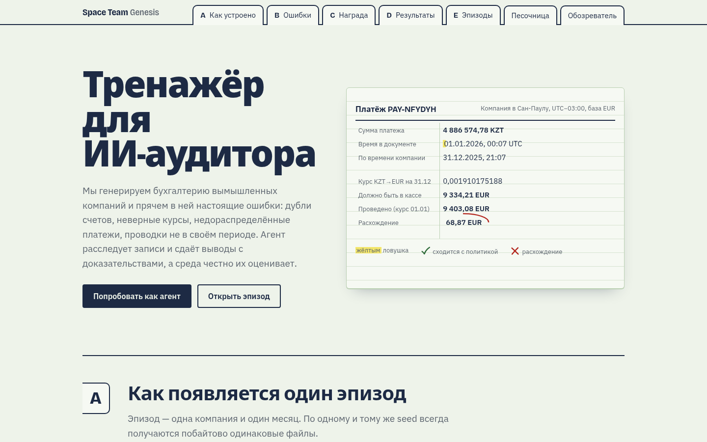
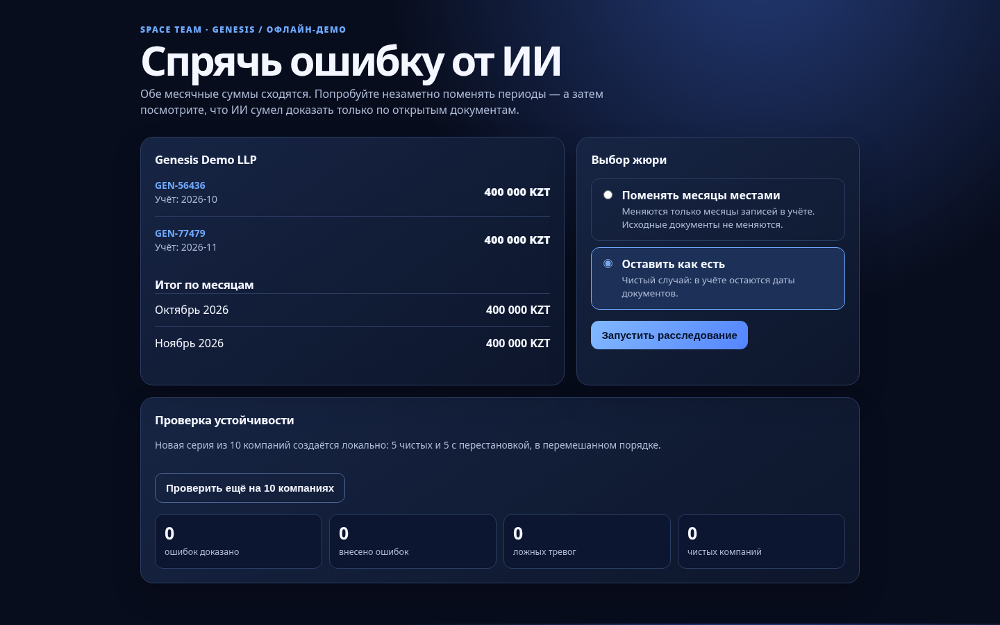

# Space Team Genesis

### A reproducible offline RL environment for evidence-based financial-audit agents

**Generate a company. Investigate through a constrained interface. Submit proof. Score behaviour—not guesses.**

[Live demo](https://aktau.digital) · [Quick start](#quick-start) · [Jury walkthrough](#jury-demo-in-45-seconds) · [API contract](docs/API_CONTRACT.md)

 

 

 

**Genesis Hackathon · Space Team · FinTech track**

---

## Overview

Space Team Genesis is **not an AI auditor or a chatbot**. It is an offline-first reinforcement-learning environment for training and evaluating agents that investigate synthetic accounting records under the same constraints as an audit workflow: limited observations, explicit actions, a fixed budget, and evidence-based submission.

For every episode, the generator creates a balanced synthetic company, introduces auditable mutations, and keeps the ground truth outside the agent process. An agent can inspect only public records and documents, then must submit findings with exact affected IDs, currency, amount, and evidence. The isolated evaluator scores only what is proved.

| In 30 seconds | What it means |
| --- | --- |
| **Reproducible** | The same seed, config, environment version, and accepted actions reproduce the same public company and transitions. |
| **Auditable** | An issue is a real difference between clean and published books, not a labelled suspicious row. |
| **Constrained** | Agents use five contract actions; no filesystem, OS, network, seed, truth, or evaluator diagnostics are exposed. |
| **Measurable** | Exact matching, false-positive penalties, and inspection cost turn an investigation into a comparable RL task. |
| **Offline** | Local runs need Python 3.11+ only—no GPU, paid API, package install, or internet connection. |

> The current public benchmark contains 20 episodes, 81 injected issues, and 4 clean companies. It is a synthetic educational environment, not an audit opinion.

## Problems and solutions

| Problem | Our solution | Impact |
| --- | --- | --- |
| LLM audit demos often score plausible prose rather than evidence. | Findings are matched against issue type, IDs, exact amount, currency, and allowed evidence. | A convincing but unsupported answer is not rewarded. |
| Synthetic data can leak labels or contain unverifiable anomalies. | A clean and published ledger are produced by the same accounting logic; the issue amount is their difference. | Every injected issue is real and independently verifiable. |
| Reward feedback can leak hidden answers. | Closed mode returns public reward 0 while truth, provenance, matching diagnostics, and internal reward remain isolated. | Agents cannot tune answers against the oracle. |
| Financial edge cases are easy to oversimplify. | Episodes include duplicates, allocation errors, FX/date errors, reporting-period errors, time zones, refunds, split payments, and legitimate distractors. | Agents must investigate records instead of pattern-match one field. |
| Agent comparisons are hard to replay. | Public NDJSON trajectories, deterministic generation, baseline policies, and a trusted experiment laboratory are included. | Results can be reproduced, compared, and diagnosed locally. |

## Why this environment is different

- **Evidence is part of the task.** A correct type alone is insufficient: the evaluator requires canonical affected IDs, exact amount, currency, and a complete public evidence set.
- **The attack surface is tested.** Public API responses, errors, and trajectories are checked for seed, truth, provenance, private paths, and matcher diagnostics.
- **The API is the environment.** The browser sandbox and external agents use the same reset/step semantics, action validator, lifecycle, and evaluator boundary.
- **Results are version-aware.** The trusted laboratory records source and environment versions, snapshots, public trajectories, known failures, comparisons, replay, and minimisation. It does not expose private evaluator artifacts.
- **The demo has an adversarially simple failure mode.** The offline jury screen keeps monthly totals equal while a month swap is only provable by opening source documents.

<strong>Implemented vs. intentionally not claimed</strong>

Implemented: deterministic data generation, public episode files, closed/open evaluation modes, isolated evaluator, HTTP transport, static UI, browser baseline agents, testable trajectories, baseline reports, laboratory replay/compare tools, Docker runtime, and the local jury demo.

Not claimed: training or hosting a proprietary foundation model, live accounting-system integrations, real-company data, tax/AP/period-end revaluation coverage, a database service, or hosted CI. The CI badge above deliberately says “not configured”; local verification is the authoritative check today.

## How it works

### Investigation loop

~~~mermaid
flowchart LR
    A[AI agent] -->|one of five actions| E[AuditEnvironment]
    E -->|public observation| A
    E -->|submit findings| V[Isolated evaluator]
    V -->|terminal reward in open mode only| E
    G[Deterministic generator] -->|public EpisodeData| E
    G -->|truth + provenance| V
    classDef trusted fill:#173b3f,stroke:#48c9b0,color:#fff;
    classDef public fill:#203250,stroke:#7da7ff,color:#fff;
    classDef private fill:#47263c,stroke:#f28ab2,color:#fff;
    class A,E public;
    class G trusted;
    class V private;
~~~

### Public actions

| Action | Purpose |
| --- | --- |
| list_records | Read a stable page of ledger, invoices, payments, or FX records. |
| get_record | Retrieve one public record by canonical ID. |
| get_document | Open one available source document. |
| calculator | Safely evaluate decimal arithmetic only. |
| submit | Send final structured findings and end the episode. |

The step budget is exactly 100 accepted actions, including submit; the time limit is 1–60 seconds. Invalid actions consume a step but return only a public error. The [API contract](docs/API_CONTRACT.md) is authoritative for fields, limits, lifecycle, and compatibility.

### Visibility boundary

| Visible to the agent, browser, and public trajectory | Available only to trusted generation/evaluation |
| --- | --- |
| Manifest, accounting policy, public records, public documents | Seed |
| Accepted action observations and public errors | truth.json, provenance.json |
| Open-mode terminal reward | Internal reward, TP/FP/FN, matcher diagnostics |
| Episode ID and bearer session token | Private paths and evaluator configuration |

## Key features

| Feature | Value | Status |
| --- | --- | --- |
| Deterministic synthetic companies | Repeatable, byte-stable episodes from seed and config | Implemented |
| Four issue types | Duplicate invoice, payment allocation, FX date/rate, reporting period | Implemented |
| Proof-carrying findings | Exact evidence requirements prevent unsupported accusations | Implemented |
| Isolated closed evaluation | Keeps truth and score signals outside the agent surface | Implemented |
| Contract-first HTTP API | Makes local browser and external agent behaviour identical | Implemented |
| Public trajectories | Makes investigation sequences inspectable and reproducible | Implemented |
| Baseline policies and reports | Establishes measurable weak and oracle reference points | Implemented |
| Trusted experiment lab | Replay, compare, scan, minimise, and restore agent snapshots | Implemented |
| Offline jury demo | Shows a document-proven period swap in under 45 seconds | Implemented |
| Hosted CI workflow | No workflow is committed to this repository | Planned |

## Architecture

~~~mermaid
flowchart TB
    subgraph Presentation
        Landing[Static landing]
        Sandbox[Manual sandbox and browser baselines]
        Explorer[Public episode explorer]
        Jury[Offline jury demo]
    end
    subgraph Runtime
        CLI[CLI and Make targets]
        HTTP[HTTP API wrapper]
        Env[AuditEnvironment reset and step]
        Generator[Synthetic generator]
        Public[Public artifacts]
        Evaluator[Isolated evaluator matcher and reward]
        Lab[Trusted lab replay and compare]
    end
    Landing --> HTTP
    Sandbox --> HTTP
    Explorer --> Public
    Jury --> Evaluator
    CLI --> Env
    HTTP --> Env
    Env --> Public
    Generator --> Public
    Generator --> Evaluator
    Env --> Evaluator
    Lab --> Evaluator
    classDef ui fill:#203250,stroke:#7da7ff,color:#fff;
    classDef core fill:#173b3f,stroke:#48c9b0,color:#fff;
    classDef private fill:#47263c,stroke:#f28ab2,color:#fff;
    class Landing,Sandbox,Explorer,Jury ui;
    class CLI,HTTP,Env,Generator,Public core;
    class Evaluator,Lab private;
~~~

There is deliberately no database, cloud model gateway, or external dependency in the execution path. Static frontend files are served alongside the API; Docker is optional packaging, not a required service.

## Product preview

Real local captures from the current implementation (1440 × 900, 22 November 2026):

| Landing: investigation workpaper | Jury demo: “Hide the error from AI” |
| --- | --- |
|  |  |

The landing is served at /; the sandbox is /play.html; the public episode explorer is /explorer.html. The jury screen is a separate local server at /hide-error-demo.

## Repository in numbers

Measured from commit [3b33fb2](https://github.com/Ar1ck-prog/Space-Team-Genesis/commit/3b33fb28c03f16a06eba4a008c2c2926fb8c6835) on **22 November 2026 UTC**. Generated outputs, dependencies, lock files, and the uncommitted README redesign were excluded from these counts.

| Metric | Verified value | Method |
| --- | ---: | --- |
| Development span | 4 calendar days · 19–22 Nov 2026 | Git first/last commit dates |
| Git commits on main | 36 | git rev-list count |
| Confirmed team members | 2 | Project UI and contract responsibility table |
| Python runtime source | 5,582 LOC | auditgym + src tracked source |
| Static frontend | 2,397 LOC | Tracked frontend files |
| Test code | 6,033 LOC | Tracked tests files |
| Test methods | 136 | unittest discovery |
| Last local test run | 136 / 136 passed in 15.654 s | 22 Nov 2026 UTC |
| Public episodes | 20 · 10 train + 10 dev | Dataset manifests |
| Injected issues / clean cases | 81 / 4 | Published dataset analysis |
| Core HTTP route patterns | 4 | Contract v1.2.0 |
| Agent actions | 5 | Contract v1.2.0 |
| Financial issue types | 4 | Contract v1.2.0 |
| Interaction scenarios | 2 | fx_invoice_partial, boundary_payment_fx_partial |
| Public trajectory entries | 952 | Committed NDJSON files |

Repository counters in the top badges are live GitHub values. “Closed PRs” is deliberately labelled as such: the GitHub/Shields endpoint counts closed pull requests, not a merged-only subset.

## Development analytics

### Source distribution

~~~mermaid
pie showData
    title Tracked product source LOC (7,979 total)
    "auditgym — generation, matching, evaluation" : 3240
    "src — environment, CLI, HTTP, integration" : 2342
    "frontend — static UI and browser agent" : 2397
~~~

### Commit activity

| Date (UTC) | Commits | Activity |
| --- | ---: | --- |
| 19 Nov | 23 | ███████████████████████ |
| 20 Nov | 3 | ███ |
| 21 Nov | 4 | ████ |
| 22 Nov | 6 | ██████ |

~~~mermaid
gantt
    title Development milestones from Git history
    dateFormat  YYYY-MM-DD
    axisFormat  %d %b
    section Core
    Contract and environment core        :done, 2026-11-19, 1d
    Generator, evaluator, baselines     :done, 2026-11-19, 1d
    section Product
    Public datasets and demo notes      :done, 2026-11-19, 2d
    Static landing and API sandbox      :done, 2026-11-21, 2d
    Jury demo and diagnostics           :done, 2026-11-22, 1d
~~~

### Baseline snapshot

The checked-in benchmark in [docs/RESULTS.md](docs/RESULTS.md) was measured on 20 November 2026 across all 20 public episodes. It is a reproducible reference snapshot, not a claim about every possible policy or model.

| Policy | F1 | Return | Interpretation |
| --- | ---: | ---: | --- |
| Random explorer | 0.2000 | −0.6032 | Weak exploratory baseline |
| Simple reconciliation | 0.4415 | −0.1484 | Detects duplicates but misses other classes |
| Mark everything | 0.0000 | −1.0000 | False-positive attack is penalised |
| Evaluator oracle | 1.0000 | +1.0000 | Trusted upper bound; not available to agents |

## Tech stack

| Area | Technology | Use |
| --- | --- | --- |
| Frontend | HTML5, CSS3, vanilla JavaScript | Static landing, explorer, manual sandbox, browser baselines |
| Backend | Python 3.11+ standard library, WSGI | CLI, HTTP transport, static serving |
| RL / AI evaluation | Gym-style reset/step, deterministic generator, matcher, reward | Agent interaction and evidence-based scoring |
| Data | JSON, JSONL, CSV, NDJSON | Public episode artifacts and trajectories |
| Database | None | Episodes are generated and served locally; no database dependency |
| Infrastructure | Docker, Nginx, Let’s Encrypt | Optional containerised deployment of the static UI and API |
| Testing | unittest | Unit, integration, dataset, HTTP, trajectory, browser, security, and jury-demo coverage |

## Project structure

~~~text
auditgym/                    synthetic generator, verifier, matcher, evaluator, policies
src/space_team_genesis/      environment, integration, CLI, HTTP and web wrapper
frontend/                    landing, sandbox, episode explorer, browser agent, public data
datasets/                    train/dev manifests
episodes/                    public files for committed episodes
trajectories/                public NDJSON trajectories and policy outputs
tests/                       unit, integration, HTTP, browser and security regression tests
docs/                        contract, design, generator, matcher, data, results, lab notes
docs/assets/readme/          verified README UI captures
~~~

## Meet the team

<table>
  <tr>
    <td align="center" width="50%">
       
      <strong>Dariy</strong> 
      <a href="https://github.com/dariy0906">@dariy0906</a> 
      Backend, HTTP transport, episode state, integration
    </td>
    <td align="center" width="50%">
       
      <strong>Arlan Mendullayev</strong> 
      <a href="https://github.com/Ar1ck-prog">@Ar1ck-prog</a> 
      Generator, environment semantics, matcher, reward, baselines and evaluation
    </td>
  </tr>
</table>

Responsibilities are taken from the [API contract](docs/API_CONTRACT.md#9-совместимость-и-ответственность), not inferred from commit volume.

## Quick start

### Requirements

- Python 3.11 or newer
- Git
- Optional: Docker for container packaging

The default local workflow has **no external Python dependencies**, no environment variables, no GPU, and no network requirement after cloning.

~~~bash
git clone https://github.com/Ar1ck-prog/Space-Team-Genesis.git
cd Space-Team-Genesis
make check
make site
~~~

| Address | Purpose |
| --- | --- |
| http://127.0.0.1:8000/ | Product landing |
| http://127.0.0.1:8000/play.html | Manual sandbox and browser baseline agents |
| http://127.0.0.1:8000/explorer.html | Public episode explorer |
| http://127.0.0.1:8000/api/v1/episodes | Core API entry point |

<strong>Other repeatable commands</strong>

~~~bash
make demo
make report
make analysis
make serve
PYTHONPATH=src:. python3 -m space_team_genesis.cli --help
docker build -t space-team-genesis .
docker run --rm --network none space-team-genesis python -m space_team_genesis.cli check
docker run --rm -p 8000:8000 space-team-genesis
~~~

## Jury demo in 45 seconds

This is the shortest offline demonstration of the project’s core claim: equal aggregate totals do not replace source-document evidence.

~~~bash
PYTHONPATH=src:. python3 -m space_team_genesis.cli jury-demo
~~~

Open http://127.0.0.1:8080/hide-error-demo.

1. Review two KZT 400,000 operations at the October/November boundary. Monthly totals are equal.
2. Select **“Swap the months”**. Only ledger months change; source documents retain 31 October and 1 November.
3. Select **“Start investigation”**. The screen shows the documents the agent actually opened—without revealing the organiser’s choice, seed, truth, or matcher diagnostics.
4. Select **“Show submitted answer”**. The UI compares ledger date, document date, agent finding, and immediately marks missed errors or false alarms.
5. Select **“Check 10 more companies”**. It generates a shuffled local batch of five clean and five swapped cases, varying dates, amounts, and document numbers while preserving equality inside each pair.

The main API is documented in [docs/DEMO.md](docs/DEMO.md); the separate jury protocol is [section 11 of the API contract](docs/API_CONTRACT.md#11-локальное-демо-спрячь-ошибку-от-ии-120).

## API and scoring

| Method | Route | Purpose |
| --- | --- | --- |
| POST | /api/v1/episodes | Start an episode and receive a public initial observation plus bearer token. |
| POST | /api/v1/episodes/{id}/steps | Run one validated action. |
| GET | /api/v1/episodes/{id} | Read the latest public episode state. |
| GET | /api/v1/episodes/{id}/trajectory | Export the public NDJSON trajectory. |

~~~json
{"kind":"list_records","table":"ledger","cursor":null,"limit":25}
~~~

~~~text
F1     = 2 × TP / (2 × TP + FP + FN)
return = clip(2 × F1 − 1 − 0.002 × inspection_steps, −1, 1)
~~~

For field definitions, canonicalisation, error codes, byte limits, response examples, and termination rules, see [API_CONTRACT.md](docs/API_CONTRACT.md).

## Documentation

| Document | What it answers |
| --- | --- |
| [AGENTS.md](AGENTS.md) | Contribution rules and private-evaluator boundaries |
| [API contract](docs/API_CONTRACT.md) | Environment, HTTP transport, lifecycle, findings, isolation, jury demo |
| [Case](docs/CASE.md) | FinTech case framing and acceptance criteria |
| [Generator](docs/GENERATOR.md) | Company generation, artifacts, invariants, and evidence |
| [Matcher](docs/MATCHER.md) | Findings, exact matching, metrics, and reward |
| [Dataset](docs/DATASET.md) | Published train/dev episodes and coverage |
| [Design](docs/DESIGN.md) | Architecture, threat model, and measured failure analysis |
| [Results](docs/RESULTS.md) | Reproducible baseline report |
| [Demo](docs/DEMO.md) | Main product demonstration flow |
| [Laboratory](docs/LAB.md) | Trusted agent-version snapshots, replay, compare, and minimisation |
| [Frontend](frontend/README.md) | Static site architecture and published data |

## Deployment

The public deployment is available at [aktau.digital](https://aktau.digital).

~~~text
Internet
  └── Nginx :443 with TLS
        └── Docker container on 127.0.0.1:8001 → 8000
              └── static frontend + /api/v1
~~~

<strong>Production update outline</strong>

~~~bash
git pull --ff-only origin main
docker build -t space-team-genesis:main .
docker rm -f space-team-genesis
docker run -d --name space-team-genesis --restart unless-stopped \
  -p 127.0.0.1:8001:8000 space-team-genesis:main
~~~

Nginx should proxy only the designated host to the loopback port. TLS is issued through a webroot-based Let’s Encrypt flow and renewed with the normal Certbot renewal mechanism. Never commit passwords, tokens, certificates, or private keys.

## Project status

| Area | Status |
| --- | --- |
| Contracted RL environment, generator, evaluator, API, data, browser UI, jury demo | Implemented and locally tested |
| Dockerised, TLS-proxied public deployment | Available |
| Hosted CI workflow | Planned; not committed |
| Real-company accounting integrations and real financial data | Out of scope |
| Tax, AP, and period-end revaluation accounting domains | Out of scope for v1 |

## Limitations

- The accounting model focuses on receivables, invoices, payments, FX, and reporting-period attribution; it excludes tax, accounts payable, and period-end revaluation.
- The generator is open source. Closed evaluations must keep fresh 53-bit seeds under trusted control.
- The environment measures proof-based behaviour on synthetic data; it is not a replacement for professional audit judgement.
- If this README and the contract disagree, [API_CONTRACT.md](docs/API_CONTRACT.md) wins.

## License

[MIT](LICENSE)
